#  serveur-linux-securise

Mise en place et **sécurisation (hardening) d'un serveur Ubuntu Server** dans une machine virtuelle VirtualBox : connexion SSH par clé uniquement, accès root interdit, gestion des utilisateurs et des droits, dossier partagé par groupe, pare-feu UFW.

## Objectif

Partir d'un serveur Linux vierge et appliquer les bonnes pratiques de base pour réduire sa surface d'attaque :

- ne pas travailler en `root`, mais avec un compte administrateur limité (`sudo`)
- appliquer le **principe du moindre privilège** (un compte sans aucun droit d'administration)
- supprimer l'authentification par mot de passe en SSH (anti brute-force)
- interdire la connexion directe de `root`
- filtrer le trafic réseau avec un pare-feu

##  Environnement

| Élément | Valeur |
|---|---|
| Hyperviseur | Oracle VirtualBox |
| Système invité | Ubuntu Server 26.04.1 LTS (noyau 7.0.0-38-generic) |
| Nom d'hôte | `corny` |
| Mémoire vive | 3272 Mo |
| Disque | volume racine `/` de 11,21 Go |
| Réseau | NAT, avec redirection de port `127.0.0.1:2222` vers `10.0.2.15:22` |
| Client | PowerShell / OpenSSH sous Windows |

##  Étapes réalisées

### 1. La machine virtuelle

Création de la VM `serveur-linux-projet` dans VirtualBox et installation d'Ubuntu Server avec le paquet **OpenSSH server**.

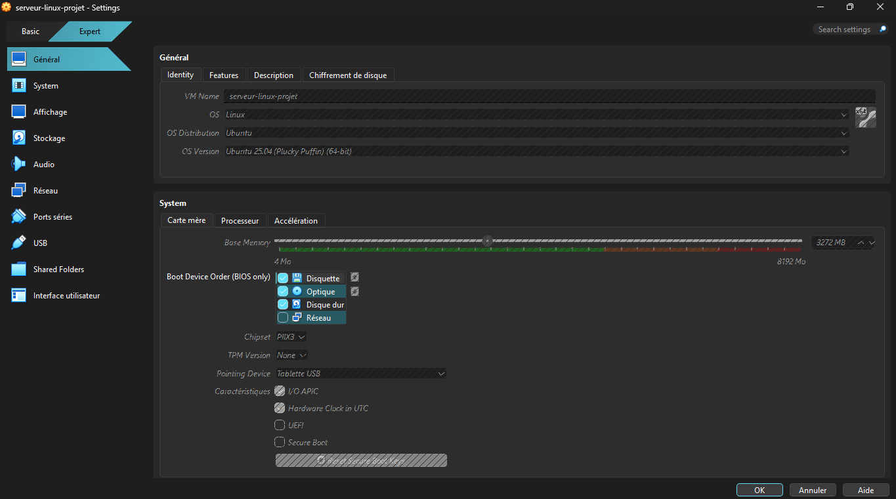

Le réseau est en **NAT** avec une règle de redirection de port : le port `2222` de Windows (`127.0.0.1`) est envoyé vers le port `22` de la VM. Comme la règle n'écoute que sur `127.0.0.1`, **seul le PC hôte peut atteindre le SSH de la VM**.

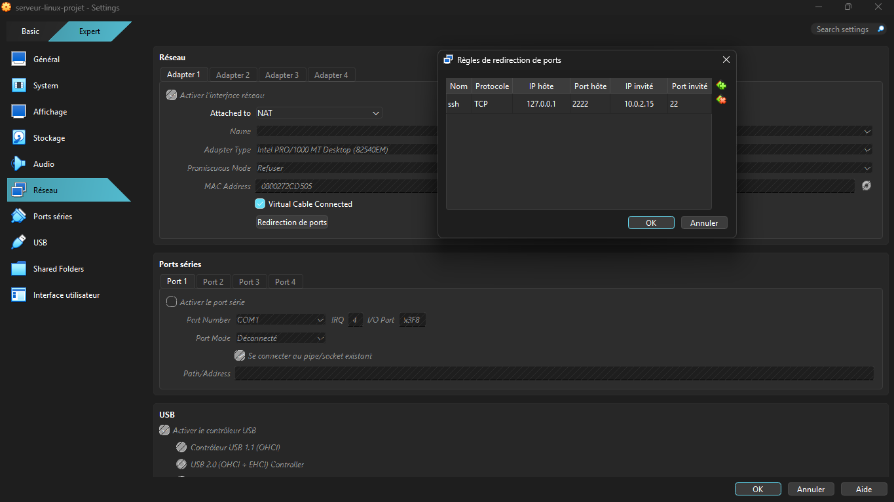

### 2. Connexion SSH par clé

Génération de la paire de clés **sur le poste Windows** (la clé privée ne quitte jamais le PC), protégée par une passphrase :

```powershell
ssh-keygen -t ed25519
```

Envoi de la clé publique vers le serveur :

```powershell
type $env:USERPROFILE\.ssh\id_ed25519.pub | ssh -p 2222 dev_corny@127.0.0.1 "mkdir -p ~/.ssh && chmod 700 ~/.ssh && cat >> ~/.ssh/authorized_keys && chmod 600 ~/.ssh/authorized_keys"
```

Connexion avec la clé (le serveur demande la passphrase de la clé, pas le mot de passe du compte) :

```powershell
ssh -p 2222 dev_corny@127.0.0.1
```

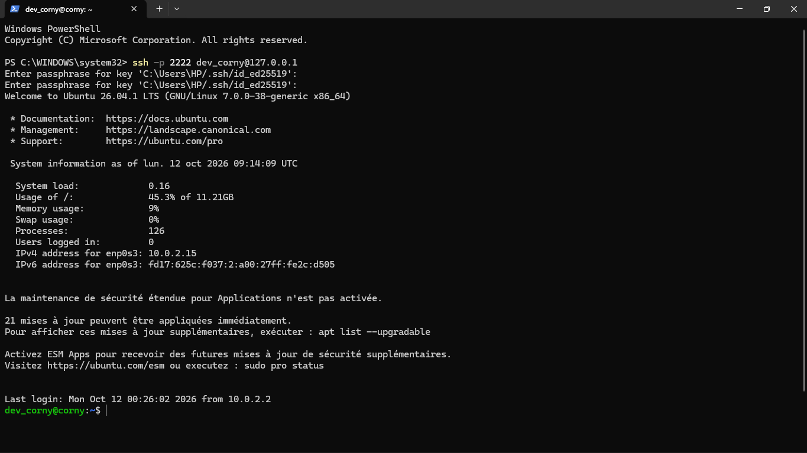

### 3. Le système

```bash
hostnamectl
```

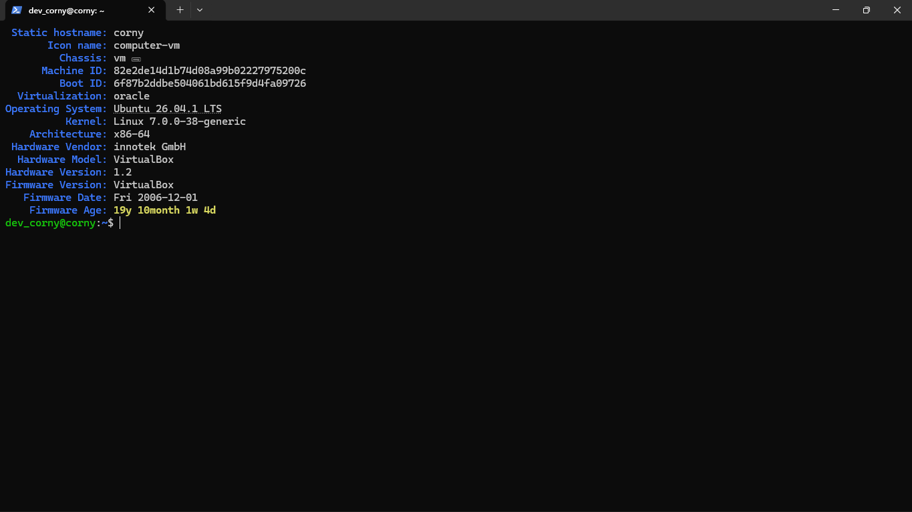

### 4. Utilisateur non-root

Le travail se fait avec le compte `dev_corny`, un utilisateur normal membre du groupe `sudo`. Les droits d'administrateur ne sont utilisés que ponctuellement, avec `sudo`.

```bash
whoami
id
sudo whoami
```

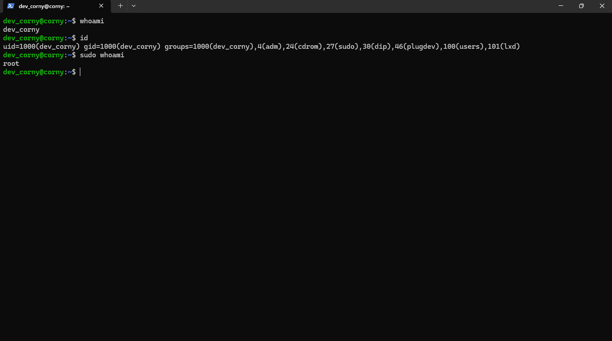

### 5. Mises à jour

```bash
sudo apt update
apt list --upgradable
sudo apt upgrade
```

23 paquets étaient à mettre à jour, dont des correctifs de sécurité.

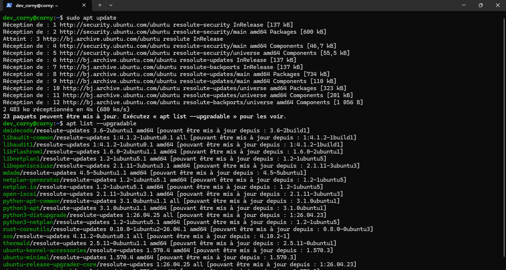

Fin de la mise à jour. L'outil `needrestart` signale que certaines sessions utilisent encore d'anciens composants : un redémarrage de la VM est recommandé pour tout recharger.

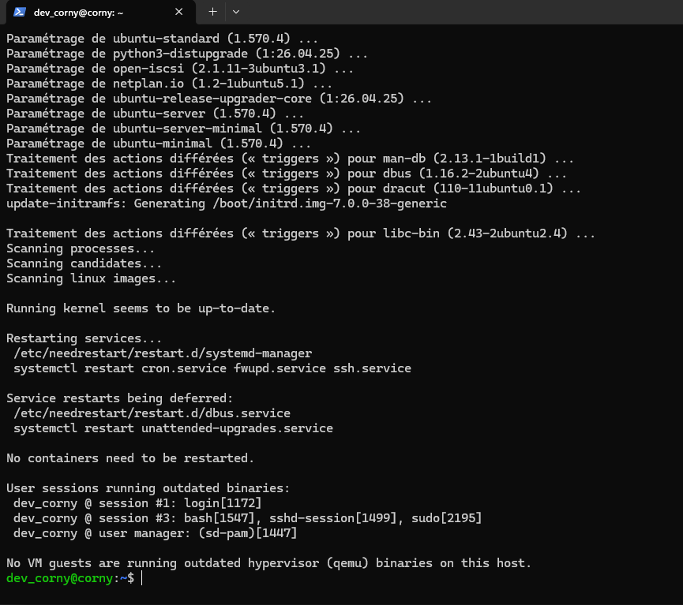

Après la mise à jour, le bandeau de connexion affiche **« 0 mise à jour »** (voir l'étape 8).

### 6. Durcissement de SSH

Fichier dédié `/etc/ssh/sshd_config.d/00-hardening.conf` :

```
PermitRootLogin no
PasswordAuthentication no
PubkeyAuthentication yes
```

Validation de la syntaxe, vérification de la configuration réellement appliquée, puis redémarrage :

```bash
sudo sshd -t
sudo sshd -T | grep -E 'passwordauthentication|permitrootlogin'
sudo systemctl restart ssh
```

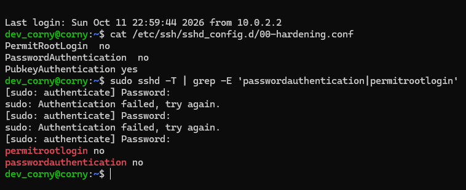

### 7. Le service SSH est actif

```bash
sudo systemctl status ssh --no-pager
ss -tln | grep :22
```

Le service tourne et écoute sur le port 22 (IPv4 et IPv6). Il démarre via `ssh.socket`, ce qui explique le `disabled` affiché sur la ligne `Loaded`.

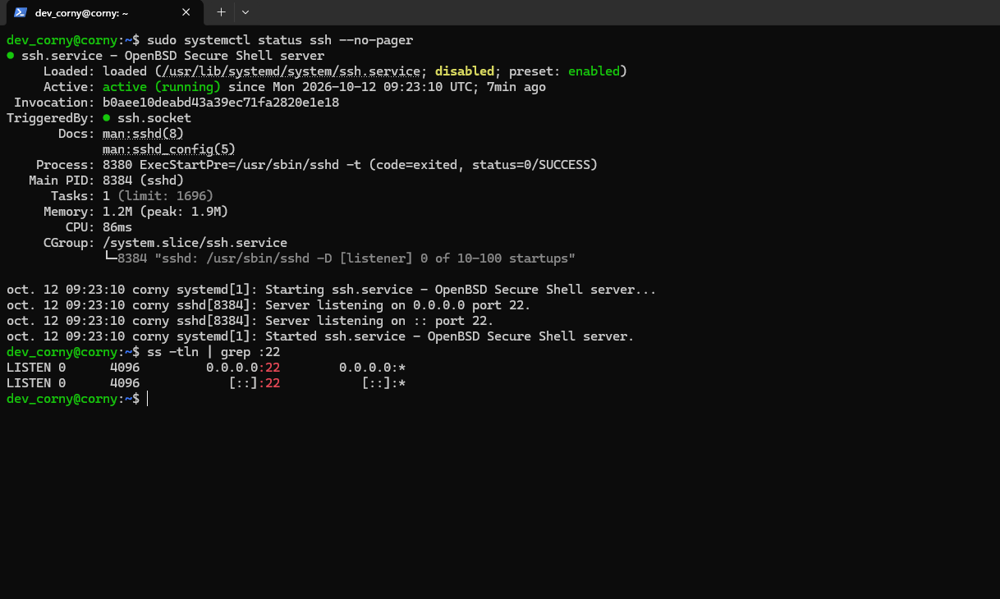

### 8. Tests de refus

Tests réalisés depuis Windows :

| Test | Résultat attendu | Résultat |
|---|---|---|
| Mot de passe (`-o PubkeyAuthentication=no`) | refusé | `Permission denied (publickey)` ✅ |
| Connexion `root` | refusée | `Permission denied (publickey)` ✅ |
| Connexion `dev_corny` avec la clé | acceptée | connexion réussie ✅ |

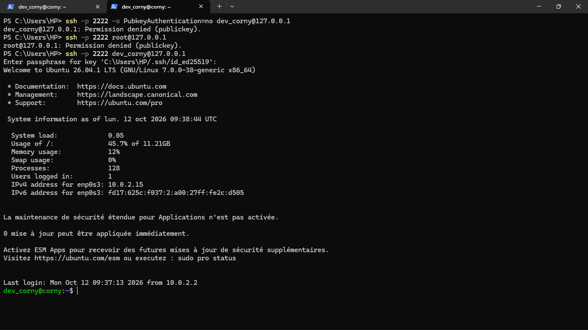

### 9. Le compte limité `stagiaire`

| Compte | Rôle | Droits |
|---|---|---|
| `dev_corny` | Administrateur | Membre du groupe `sudo` |
| `stagiaire` | Compte de test, limité | Aucun droit `sudo` |

Test du moindre privilège : `stagiaire` tente `sudo apt update` et se fait refuser (`sudo: I'm sorry stagiaire. I'm afraid I can't do that`). Ce compte de test a été créé sans dossier personnel, d'où l'avertissement `cannot change directory to /home/stagiaire`.

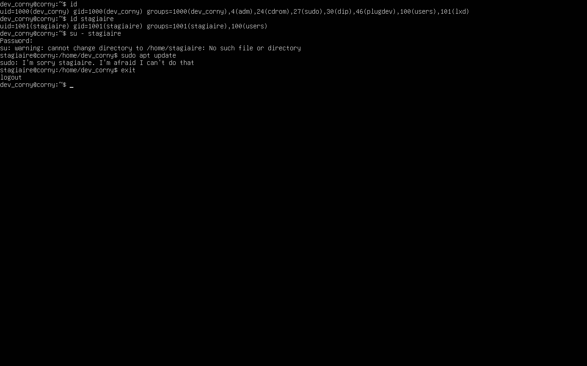

### 10. Groupe et dossier partagé

Création d'un groupe `projet` regroupant `dev_corny` et `stagiaire`, et d'un dossier partagé `/srv/partage` accessible **uniquement** aux membres du groupe :

```bash
sudo groupadd projet
sudo usermod -aG projet dev_corny
sudo usermod -aG projet stagiaire
sudo mkdir /srv/partage
sudo chown root:projet /srv/partage
sudo chmod 2770 /srv/partage
```

Les droits `2770` signifient :

- `7` pour le propriétaire (`root`) et `7` pour le groupe `projet` : lecture, écriture et accès
- `0` pour les autres : aucun accès
- le `2` initial est le **setgid** : tout nouveau fichier créé dans le dossier appartient automatiquement au groupe `projet`

**Tests :**

| Test | Résultat |
|---|---|
| `dev_corny` et `stagiaire` créent un fichier dans `/srv/partage` | réussi, les deux fichiers appartiennent au groupe `projet` ✅ |
| Un compte hors du groupe (`nobody`) liste le dossier | `Permission refusée` ✅ |

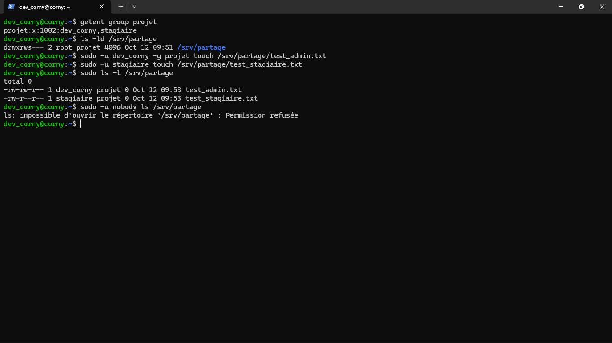

### 11. Pare-feu UFW

Politique par défaut : tout le trafic entrant est bloqué, le trafic sortant est autorisé. Seul SSH est ouvert, avec limitation du nombre de tentatives de connexion (`limit`).

```bash
sudo ufw default deny incoming
sudo ufw default allow outgoing
sudo ufw limit OpenSSH
sudo ufw enable
sudo ufw status verbose
```

L'ordre est important : la règle SSH doit exister **avant** l'activation du pare-feu, sinon on se coupe l'accès au serveur.

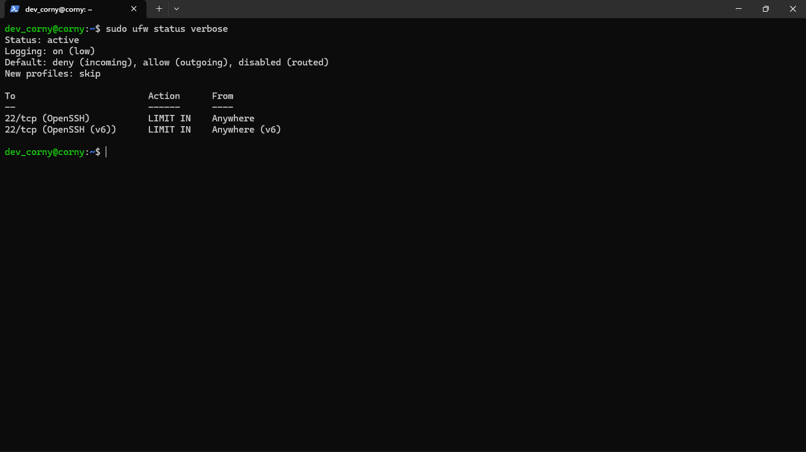

##  Choix de sécurité

- **Clé ed25519 + passphrase** : sans la clé privée et sa passphrase, aucune connexion n'est possible.
- **Mot de passe SSH désactivé** : supprime l'attaque par brute-force sur les mots de passe.
- **Root interdit en SSH** : `root` est la cible n°1 des attaquants. L'administration passe par `sudo`.
- **Redirection de port limitée à `127.0.0.1`** : le SSH de la VM n'est joignable que depuis le PC hôte.
- **Configuration dans `sshd_config.d/`** : fichier séparé et chargé en priorité, plus propre qu'une modification du fichier principal.
- **`ufw limit`** : bloque les adresses qui multiplient les tentatives de connexion.
- **Moindre privilège** : un compte sans `sudo` pour les usages limités.
- **Dossier partagé en `2770` + setgid** : accès réservé au groupe `projet`, avec héritage automatique du groupe sur les nouveaux fichiers.

##  Ce que j'ai appris

- Gérer des utilisateurs, des groupes et les droits `sudo`
- Comprendre les permissions Unix (`rwx`) et le bit setgid pour un dossier partagé
- Générer et déployer une clé SSH, et vérifier ce que le serveur applique réellement (`sshd -T`)
- Garder une session SSH ouverte comme **porte de secours** avant de durcir une configuration
- Configurer un pare-feu dans le bon ordre pour ne pas se verrouiller dehors
- Savoir sur quelle machine on tape chaque commande (client Windows ou serveur)

## Pistes d'amélioration

- Retirer `dev_corny` du groupe `lxd` : on le voit sur la capture de l'étape 4, et ce groupe est considéré comme équivalent à `root`
- Redémarrer la VM après la mise à jour, comme le recommande `needrestart`
- Utiliser des ACL ou ajuster l'`umask` pour que les membres du groupe puissent modifier les fichiers des autres (aujourd'hui, un fichier créé par `stagiaire` est en lecture seule pour le groupe)
- Installer `fail2ban`
- Vérifier la configuration de `unattended-upgrades` (le service est déjà présent)
- Mettre en place la surveillance des connexions (`journalctl`, `lastlog`)

## Sécurité du dépôt

Ce dépôt ne contient **aucune clé privée** ni aucun mot de passe. Le fichier `.gitignore` bloque les clés privées courantes, et les captures d'écran ont été relues avant publication.
